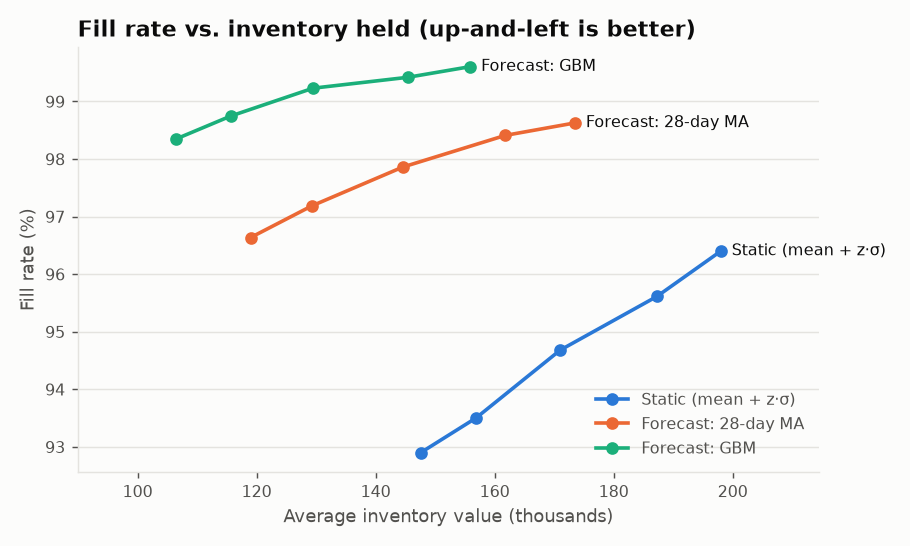
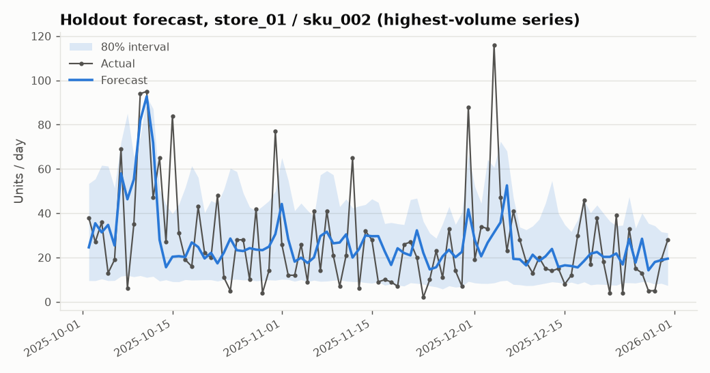
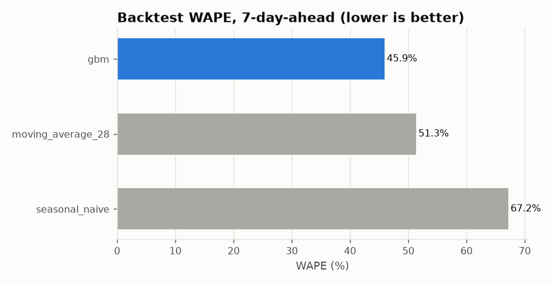

# stockcast: demand forecasting → inventory decisions


A forecast only pays off when it changes a decision. This project builds a **global gradient boosted demand forecaster** for 100 store × SKU series, validates it the way time series should be validated, and then **replays the forecasts through an inventory simulation** to measure the business result: fill rate, inventory held and cost.

```bash
pip install -e ".[dev]"
stockcast --out reports      # ~1 minute: data → features → backtest → holdout → simulation → figures
pytest
```

## Headline results (91-day holdout, Oct to Dec 2025, including the holiday peak)

| | Seasonal naive | 28-day moving avg | **Gradient boosting** |
|---|---:|---:|---:|
| Backtest WAPE (4 rolling folds) | 67.2% | 51.3% | **45.9%** |
| Holdout WAPE | 67.9% | 50.8% | **45.7%** |
| Holdout bias | +0.6% | +2.4% | −4.6% |

All three inventory policies target 95% service with a 3-day lead time and 4-day review period:

| Policy | Fill rate | Avg. inventory value | Total cost* |
|---|---:|---:|---:|
| Static: `ROP = μL + zσ√L` | 94.7% | 171.0k | 351.9k |
| Forecast-driven, 28-day MA | 97.9% | 144.6k | 275.8k |
| **Forecast-driven, GBM** | **99.2%** | **129.5k (−24%)** | **235.4k (−33%)** |

\*Holding cost + lost-sales penalty + fixed ordering cost, summed over 100 series.



At every service target, the GBM-driven policy holds less stock **and** stocks out less. The textbook static policy misses its own target because the demand it sees is seasonal and promotion-driven, not stationary.




## What's in it

**Data** (`data.py`). Synthetic but realistic: trend, weekly and yearly seasonality that differs by category, promotions with price cuts and SKU-level price elasticity, US federal holidays, a pre-Christmas surge, and negative-binomial noise that includes slow, intermittent SKUs. Because the generating process is known, the tests can check that the model recovers real effects.

**Features** (`features.py`). Lags of 7 to 364 days, rolling means, std and EWM, calendar encodings, price ratio, promotions and days to Christmas. Every demand-derived feature is shifted by at least the 7-day horizon, and a test proves it: tampering with the last 7 days of sales leaves every feature for the final day unchanged.

**Models** (`models.py`). One global `HistGradientBoostingRegressor` with **Poisson loss** (suited to non-negative, overdispersed counts) and native categorical handling, compared against seasonal-naive and moving-average baselines. Quantile-loss variants give an 80% prediction interval.

**Validation** (`evaluation.py`). Rolling-origin backtest with 4 folds × 28 days, refitting each fold, plus an untouched 91-day holdout. Metrics are WAPE, MAE, RMSE and bias. WAPE is used instead of MAPE because MAPE is undefined on zero-sales days.

**Inventory** (`inventory.py`). A day-by-day simulation of reorder-point / order-up-to policies with lead time, a pipeline of open orders, and lost sales. Safety stock uses each series' **out-of-sample** forecast-error σ from the backtest, not in-sample residuals. With lead time + review = 7 = the forecast horizon, every decision uses only forecasts that would have existed on that day, so the simulation is leakage-free too.

## Honest caveats

- The 80% interval covers **75.4%** of holdout actuals, so it is slightly too narrow, mostly during the holiday spike. Conformal calibration on backtest residuals would be the next step.
- The forecast-driven policies overshoot their service targets (99.2% vs 95%), so the safety-stock σ is conservative. Tuning σ against the target would lower inventory further.
- The data is synthetic. To run this on real data such as the M5 / Walmart competition data, replace `generate_sales()` with a loader that returns the same columns.

## Project layout

```
src/stockcast/
  data.py         synthetic demand generator
  features.py     leakage-safe feature engineering
  models.py       baselines + gradient boosting (point & quantile)
  evaluation.py   metrics, rolling-origin backtest
  inventory.py    policy construction + simulation
  pipeline.py     end-to-end run, writes reports/
tests/            leakage test, hand-checked simulation, model-vs-baseline, monotonicity
```

## License

MIT
